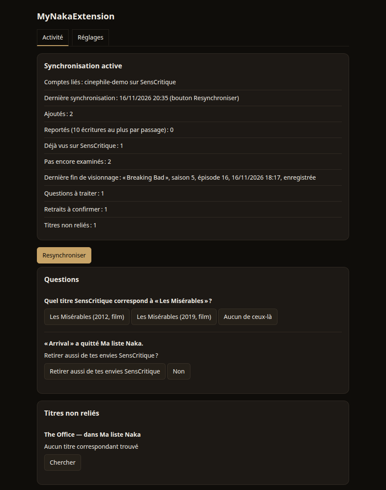
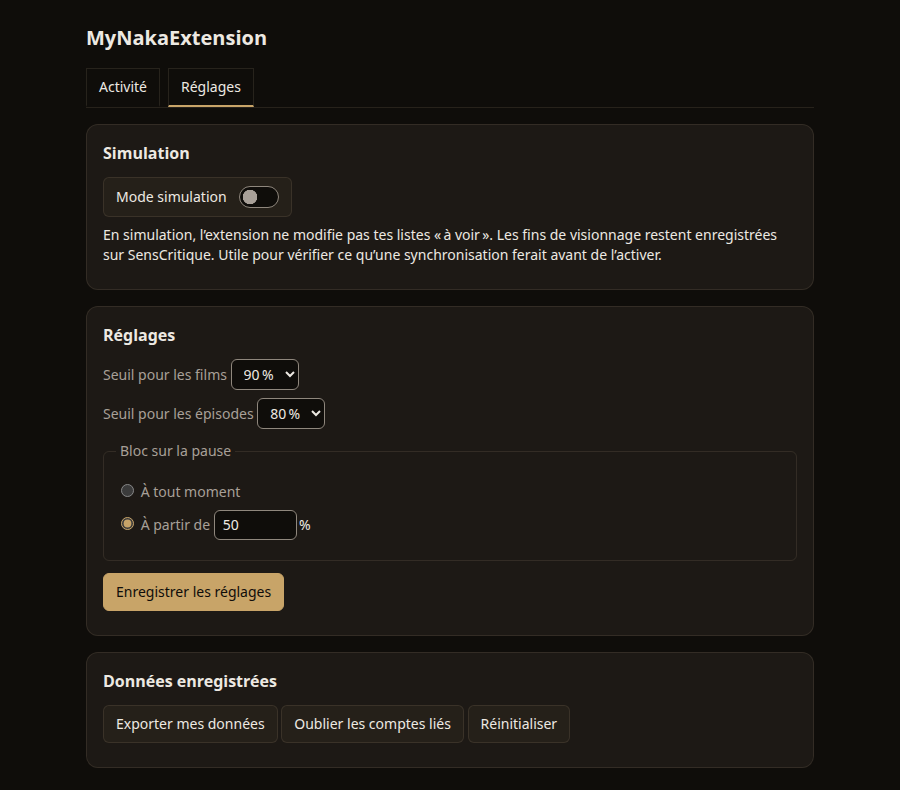
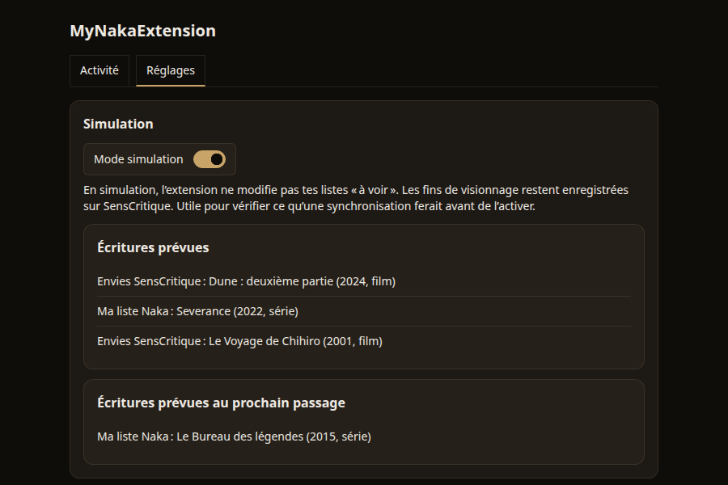

# MyNakaExtension

[English](README.md)

Une extension Chromium (Brave, Chrome ; Manifest V3) qui relie le site de streaming Naka à
SensCritique. Quand tu finis un film ou un épisode sur Naka, il est marqué vu sur SensCritique et tu
peux le noter sans quitter la page ; tes deux listes « à voir » restent synchronisées dans les deux sens.



## Ce qu’elle fait

- **Fins de visionnage.** Un film ou un épisode regardé au-delà de ton seuil (90 % pour un film, 80 %
  pour un épisode par défaut), au-delà du début du générique, ou coché « vu », est marqué vu sur
  SensCritique, à la date de ton jour local. Un film fini quitte tes envies SensCritique ; une série,
  jamais.
- **Noter depuis Naka.** Un bloc de note apparaît à la fin d’un titre, sur la pause, dans une rangée
  « À traiter » de l’accueil et dans l’encadré d’infos de chaque fiche (avec des étoiles par épisode).
  La saison et la série sont proposées quand elles sont finies, avec la moyenne de tes notes comme point
  de départ. Une note donnée depuis une fiche s’annule pendant 10 minutes.
- **Synchronisation des listes.** « Ma liste » de Naka et tes envies SensCritique avancent ensemble. La
  première synchronisation ne fait qu’ajouter ; un retrait d’un côté devient une question avant
  d’atteindre l’autre ; un titre ambigu est demandé, jamais deviné.
- **Une page de l’extension** (Activité / Réglages) montre la dernière synchronisation, les questions
  ouvertes, les titres non reliés (avec une recherche pour les relier à la main), les titres traités et
  les réglages.

| Réglages | Mode simulation |
| --- | --- |
|  |  |

Les captures utilisent des données inventées. Les pages de Naka refusent les navigateurs automatisés :
les blocs affichés sur Naka ne sont donc pas capturés ici.

## Installation

L’extension n’est distribuée que sur GitHub (pas de boutique de navigateur).

1. Télécharge `MyNakaExtension-<version>.zip` depuis la dernière
   [Release](https://github.com/K-Schmitt/MyNakaExtension/releases/latest) et décompresse-le.
2. Ouvre `brave://extensions` (ou `chrome://extensions`) et active le **Mode développeur**.
3. Clique sur **Charger l’extension non empaquetée** et choisis le dossier décompressé.
4. Sois connecté à SensCritique dans le même navigateur et garde un onglet Naka ouvert : l’extension
   agit avec tes propres sessions.

À l’installation, les écritures sont actives, mais la première synchronisation t’attend : clique sur
« Resynchroniser » dans la page de l’extension (elle ne fait qu’ajouter, 10 écritures au plus). Active
d’abord la simulation dans Réglages si tu veux voir ce qu’elle écrirait : la simulation ne retient que
les écritures de listes, les fins de visionnage restent écrites.

## Confidentialité

Tout reste dans le stockage d’extension de ton navigateur. Les requêtes vont à naka.cx et à
senscritique.com pour ton compte, plus les affiches chargées depuis image.tmdb.org et
media.senscritique.com ; rien n’arrive au développeur, ni statistiques, ni code tiers. Les jetons de
session ne sont jamais enregistrés. Tu peux exporter ou effacer tes données depuis l’onglet Réglages.
Détails : [PRIVACY.fr.md](PRIVACY.fr.md).

## Comment ça marche

Il n’y a pas de serveur. L’extension appelle les API internes des deux sites depuis le navigateur, avec
la session que tu as déjà, et répartit le travail entre trois contextes pour que chaque secret reste là
où il naît :

```text
 Onglet Naka                                                 Service worker
┌──────────────────────────────────────────────┐           ┌───────────────────────────────────┐
│ Monde MAIN (naka-main.js)                    │           │ sw.js                             │
│  enveloppe le fetch de la page, lit des      │           │  une seule file de travaux :      │
│  copies de quelques réponses, ne transmet    │           │  synchros, fins, notes, remises   │
│  que des ids et des titres                   │           │  à zéro, une par une              │
│            │ messages window (vérifiés)      │           │  seul à écrire dans le stockage   │
│            ▼                                 │  messages │  client GraphQL SensCritique :    │
│ Monde isolé (naka-isolated.js)               │◀─────────▶│  jeton SC lu dans la session à    │
│  garde le jeton Naka, appelle naka.cx/api/v1 │ (vérifiés)│  chaque appel, jamais enregistré  │
│  pour le worker ; suit la lecture ; dessine  │           │                                   │
│  les blocs dans une racine fantôme fermée    │           │                                   │
└──────────────────────────────────────────────┘           └───────────────────────────────────┘
                                                                   ▲ messages runtime (vérifiés)
                                                           ┌───────┴───────────────────────────┐
                                                           │ Page de l’extension (status.html) │
                                                           └───────────────────────────────────┘
```

- **La page ne voit que des identifiants.** Le script du monde MAIN observe les requêtes de Naka et ne
  transmet que des ids, des titres et le début du générique ; il ne lit jamais un en-tête, ne transmet
  jamais un jeton et ne modifie jamais une requête ni une réponse.
- **Le jeton Naka ne quitte jamais l’onglet Naka.** Seul le script de contenu isolé le lit, et ne
  l’envoie qu’en `Bearer` à `naka.cx/api/v1`. Le worker demande à cet onglet de faire les appels Naka
  pour lui.
- **Le jeton SensCritique n’est jamais enregistré.** Le worker le lit dans la session connectée au
  moment de chaque appel authentifié, ne l’envoie qu’à l’API de SensCritique (`credentials: "omit"`,
  sans suivre de redirection) et le tient hors des messages, des erreurs et des journaux.
- **Des parsers stricts partout.** Chaque message entre contextes et chaque valeur stockée passe par un
  parser qui reconstruit un objet neuf à partir des clés connues et refuse tout le reste. Une liste lue
  en partie arrête la synchronisation au lieu d’être prise pour vide.
- **Des gardes sur les écritures.** Les notes, les réponses aux questions, les liaisons, les retraits
  et l’annulation exigent un vrai clic (`isTrusted`) sur un contrôle de l’extension, dans une racine
  fantôme fermée, au moins 0,4 s après son apparition, et visible à l’écran depuis 300 ms
  (IntersectionObserver v2), contre les clics cachés. Les écritures automatiques sont bornées par des
  budgets : une synchronisation des listes fait 10 écritures au plus, et la toute première attend un
  clic ; une fin de visionnage ne compte que pour le titre en cours de lecture, après une vraie lecture,
  30 par heure au plus et une en attente par titre. Le mode simulation liste les écritures de listes
  qu’une synchronisation ferait sans les faire (les fins restent écrites).
- **Échec fermé.** Un autre compte connecté sur l’un des deux sites arrête tout travail avant la moindre
  écriture. Un coupe-circuit cesse d’appeler un site pour le reste du travail après un refus pour trop de
  requêtes (HTTP 429) ou une erreur de session sur l’un des deux sites, ou une requête SensCritique
  qui dépasse son délai.
- **Permissions minimales.** `storage`, et l’accès aux seuls hôtes `naka.cx`, `www.senscritique.com` et
  `apollo.senscritique.com`. Aucun code distant, aucun `eval`.

La logique pure (seuils, rapprochement des titres, synchronisation, fins de visionnage) vit dans
`src/core/`, à part de tout ce qui touche `chrome.*` ou une page, et se teste sans navigateur.

| Dossier | Rôle |
| --- | --- |
| `src/core/` | Logique pure : seuils, rapprochement des titres, synchronisation, fins, fiches de note |
| `src/sc/`, `src/naka/` | Clients des sites (GraphQL SensCritique, API Naka) |
| `src/ext/` | Messages et leurs parsers, schémas des données stockées, stockage |
| `src/sw/` | Service worker : file de travaux, routeur, travaux |
| `src/content/` | Onglet Naka, monde isolé ; `ui/` contient les blocs |
| `src/page/` | Page Naka, monde MAIN (observateur de fetch) |
| `src/status/` | La page de l’extension |

## Développement

Il faut Node 22 (`.nvmrc`) et npm.

```bash
npm ci
npm run check   # Biome (lint + format), tsc sur src et tests, Vitest, puis le build dans dist/
```

| Commande | Rôle |
| --- | --- |
| `npm run check` | Le gate : lint, types, environ 5 400 tests, build |
| `npm test` | Vitest, une passe |
| `npm run coverage` | Rapport de couverture dans `coverage/` |
| `npm run build` | Assemble les quatre points d’entrée avec esbuild dans `dist/`, chargeable non empaqueté |

TypeScript strict, sans framework d’interface, sans dépendance à l’exécution. En plus des tests
unitaires, la synchronisation des listes est vérifiée par une simulation aléatoire de milliers
d’historiques, dont les règles de sécurité jugent ce que le monde simulé a fait. Les décisions, les
options écartées et les limites connues sont tenues dans [NOTES.md](NOTES.md) ; les changements par
version sont dans [CHANGELOG.md](CHANGELOG.md) (en anglais).

## Avertissement

- Projet non officiel, sans lien avec Naka ni SensCritique, ni approuvé ni soutenu par eux.
- Il repose sur des API internes non documentées des deux sites. Elles peuvent changer à tout moment, et
  l’extension peut cesser de fonctionner sans préavis.
- Navigateurs Chromium de bureau seulement : les navigateurs mobiles n’exécutent pas d’extensions.
- Tu es responsable de ton usage des deux sites et de leurs conditions.

## Licence

[MIT](LICENSE) © 2026 Kylian Schmitt
