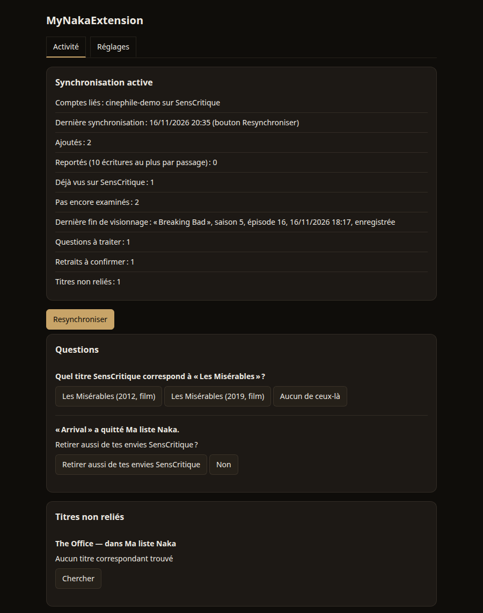
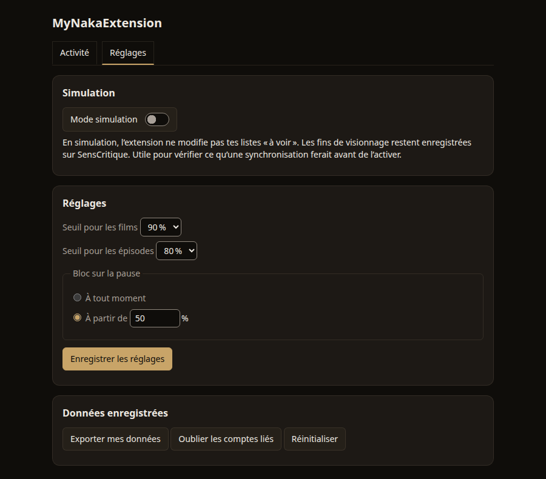
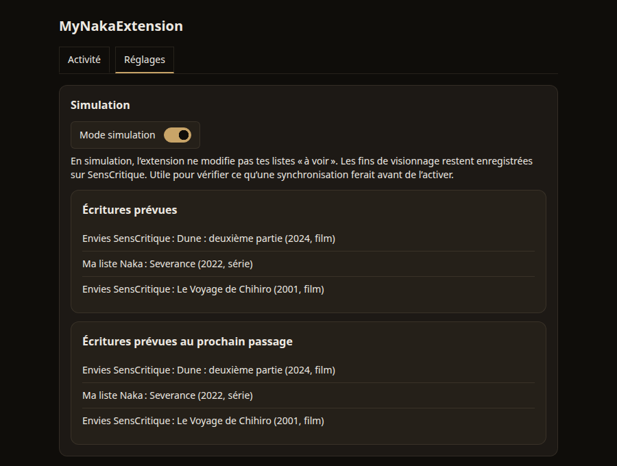

# MyNakaExtension

[Français](README.fr.md)

A Chromium extension (Brave, Chrome; Manifest V3) that connects the streaming site Naka to
SensCritique. When you finish a film or an episode on Naka, it is marked as seen on SensCritique and
you can rate it without leaving the page; your two watchlists stay in sync both ways.

The extension's interface is in French.



## What it does

- **Finishes.** A film or episode watched past your threshold (90% for films, 80% for episodes by
  default), past the start of the credits, or ticked « vu » is marked seen on SensCritique, dated with
  your local day. A finished film leaves your SensCritique watchlist; a series never does.
- **Ratings from Naka.** A rating block appears at the end of a title, on pause, in an « À traiter » row
  on the home page and in the info panel of each title page (with per-episode stars). The season and
  the series are offered once they are finished, with the average of your ratings as a starting point.
  A rating from a title page can be undone for 10 minutes.
- **Watchlist sync.** Naka's « Ma liste » and your SensCritique watchlist are kept in step. The first
  sync only adds; a removal on one side becomes a question before it reaches the other; ambiguous titles
  are asked, never guessed.
- **An extension page** (Activité / Réglages) shows the last sync, the open questions, the titles it
  could not link (with a search to link them by hand), the titles handled, and the settings.

| Réglages | Simulation mode |
| --- | --- |
|  |  |

The captures use made-up data. Naka's pages refuse automated browsers, so the blocks shown on Naka
itself are not captured here.

## Install

The extension is distributed on GitHub only (no browser store).

1. Download `MyNakaExtension-<version>.zip` from the latest
   [Release](https://github.com/K-Schmitt/MyNakaExtension/releases/latest) and unzip it into a new
   folder.
2. Open `brave://extensions` (or `chrome://extensions`) and turn on **Developer mode**.
3. Click **Load unpacked** (« Charger l'extension non empaquetée ») and pick the unzipped folder.
4. Be logged in to SensCritique in the same browser, and keep a Naka tab open: the extension acts
   through your own sessions.

To update, replace the files in that same folder with the new version's, then click the reload button
(circular arrow) on the extension's card. A different folder loads a second extension, with empty
storage.

On a fresh install, writes are on, but the first sync waits for you: click « Resynchroniser » on the
extension's page (it adds only, at most 10 writes). Turn on simulation in Réglages first if you want to
see what it would write: simulation holds back list writes only, finishes are still written.

## Privacy

Everything stays in your browser's extension storage. Requests go to naka.cx and senscritique.com on
your behalf, plus poster images from image.tmdb.org and media.senscritique.com; nothing reaches the
developer, no analytics, no third-party code. Session tokens are never stored. You can export or erase
your data from the Réglages tab. Details: [PRIVACY.md](PRIVACY.md).

## How it works

There is no server. The extension calls both sites' internal APIs from the browser, with the session
you already have, and splits the work across three contexts so that each secret stays where it is born:

```text
 Naka tab                                                    Service worker
┌──────────────────────────────────────────────┐           ┌───────────────────────────────────┐
│ MAIN world (naka-main.js)                    │           │ sw.js                             │
│  wraps the page's fetch, reads copies of a   │           │  one job queue: syncs, finishes,  │
│  few responses, forwards ids and titles only │           │  ratings and resets run one by one│
│            │ window messages (checked)       │           │  the only writer of storage       │
│            ▼                                 │  runtime  │  SensCritique GraphQL client:     │
│ Isolated world (naka-isolated.js)            │◀─────────▶│  SC token read from the logged-in │
│  holds the Naka token, calls naka.cx/api/v1  │  messages │  session per call, never stored   │
│  for the worker; tracks playback; draws the  │ (checked) │                                   │
│  blocks in a closed shadow root              │           │                                   │
└──────────────────────────────────────────────┘           └───────────────────────────────────┘
                                                                   ▲ runtime messages (checked)
                                                           ┌───────┴───────────────────────────┐
                                                           │ Extension page (status.html)      │
                                                           └───────────────────────────────────┘
```

- **The page sees ids only.** The MAIN-world script observes Naka's own requests and passes on ids,
  titles and the start of the credits; it never reads a header, never forwards a token, and never
  alters a request or a response.
- **The Naka token never leaves the Naka tab.** Only the isolated content script reads it, and only
  sends it as `Bearer` to `naka.cx/api/v1`. The worker asks that tab to make Naka calls for it.
- **The SensCritique token is never stored.** The worker reads it from the logged-in session at the
  moment of each authenticated call, sends it only to SensCritique's API (`credentials: "omit"`, no
  redirects), and keeps it out of messages, errors and logs.
- **Strict parsers everywhere.** Every message between contexts and every stored value goes through a
  parser that rebuilds a fresh object from known keys and refuses anything else. A list read
  incompletely stops the sync instead of being taken as empty.
- **Write guards.** Ratings, answers to questions, links, removals and undo need a real (`isTrusted`)
  click on one of the extension's own controls, in a closed shadow root, at least 0.4 s after it
  appeared, and visibly on screen for 300 ms (IntersectionObserver v2), against hidden clicks. The
  automatic writes are capped by budgets: a list sync makes at most 10 writes, and the very first sync
  waits for a click; a finish counts for the title playing once it passes its threshold or the credits,
  or for a « vu » you tick: the playing title's counts after real playback, without a click, another
  title's needs a real click, one per click; at most 30 per hour and one pending per title. Simulation
  mode lists the list writes a sync would make without making them (finishes are still written).
- **Fail closed.** Another account signed in on either site stops every job before it writes. A circuit
  breaker stops calling a site for the rest of the job after a rate limit (HTTP 429) or a session error
  on either site, or a timed-out SensCritique request.
- **Minimal permissions.** `storage`, and host access to `naka.cx`, `www.senscritique.com` and
  `apollo.senscritique.com` only. No remote code, no `eval`.

Pure logic (thresholds, title matching, list sync, finish handling) lives in `src/core/`, apart from
anything that touches `chrome.*` or a page, and is tested without a browser.

| Folder | Role |
| --- | --- |
| `src/core/` | Pure logic: thresholds, title matching, list sync, finish handler, rating cards |
| `src/sc/`, `src/naka/` | Site clients (SensCritique GraphQL, Naka API) |
| `src/ext/` | Messages and their parsers, stored data schemas, storage |
| `src/sw/` | Service worker: job queue, router, jobs |
| `src/content/` | Naka tab, isolated world; `ui/` holds the blocks |
| `src/page/` | Naka page, MAIN world (fetch observer) |
| `src/status/` | The extension's page |

## Development

Requires Node 22 (`.nvmrc`) and npm.

```bash
npm ci
npm run check   # Biome (lint + format), tsc on src and tests, Vitest, then the build into dist/
```

| Command | What it does |
| --- | --- |
| `npm run check` | The gate: lint, type check, about 5,400 tests, build |
| `npm test` | Vitest, single run |
| `npm run coverage` | Coverage report in `coverage/` |
| `npm run build` | Bundle the four entries with esbuild into `dist/`, loadable unpacked |

TypeScript strict, no UI framework, no runtime dependency. Beyond unit tests, the list sync is checked
by a randomised simulation of thousands of histories whose safety rules judge what the simulated world
did. Design decisions, rejected options and known limits are logged in [NOTES.md](NOTES.md) (in
French); changes per version are in [CHANGELOG.md](CHANGELOG.md).

## Limits

- This is an unofficial project, not affiliated with, endorsed by or supported by Naka or SensCritique.
- It relies on undocumented internal APIs of both sites. They can change at any time, and the extension
  may stop working without notice.
- Chromium desktop browsers only: mobile browsers do not run extensions.
- A « vu » ticked outside the player counts only within 3 s of your click, one per click. A Naka action
  that marks a whole season or series seen in one click sends several « vu »: only the first one counts.
  On a slow connection, where Naka's request leaves more than 3 s after the click, the « vu » does not
  count.
- You are responsible for your use of both sites and of their terms.

## License

[MIT](LICENSE) © 2026 Kylian Schmitt
